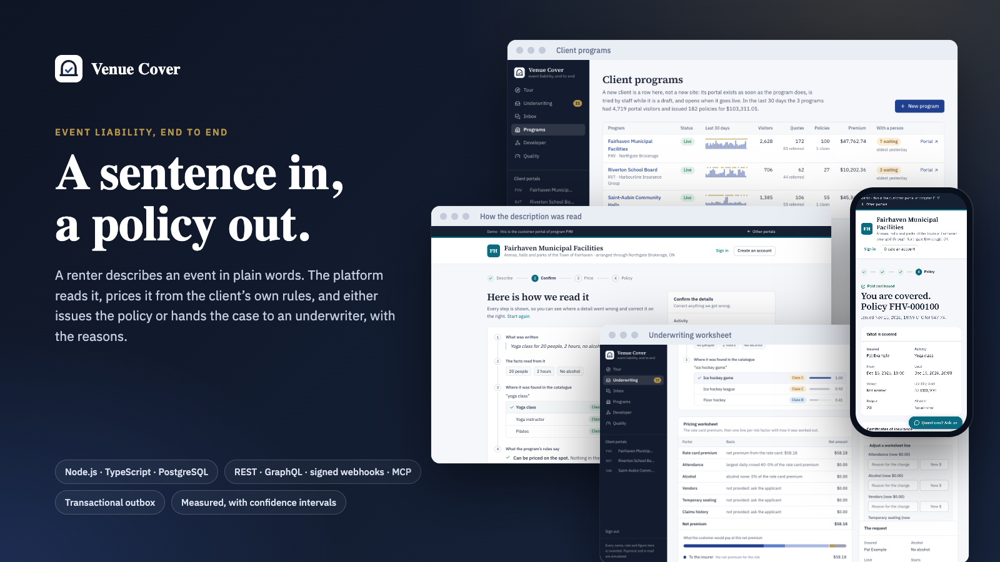
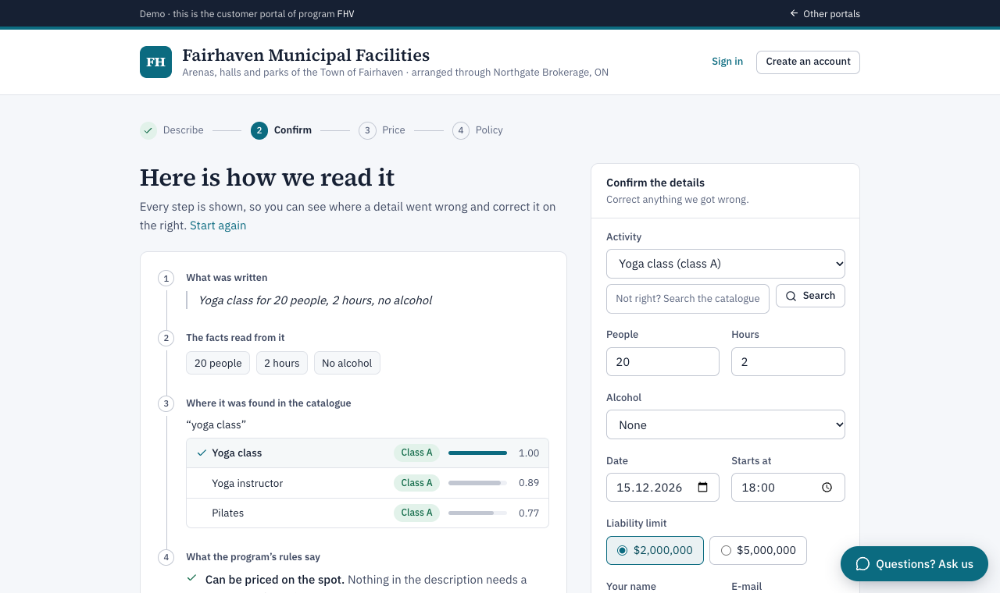
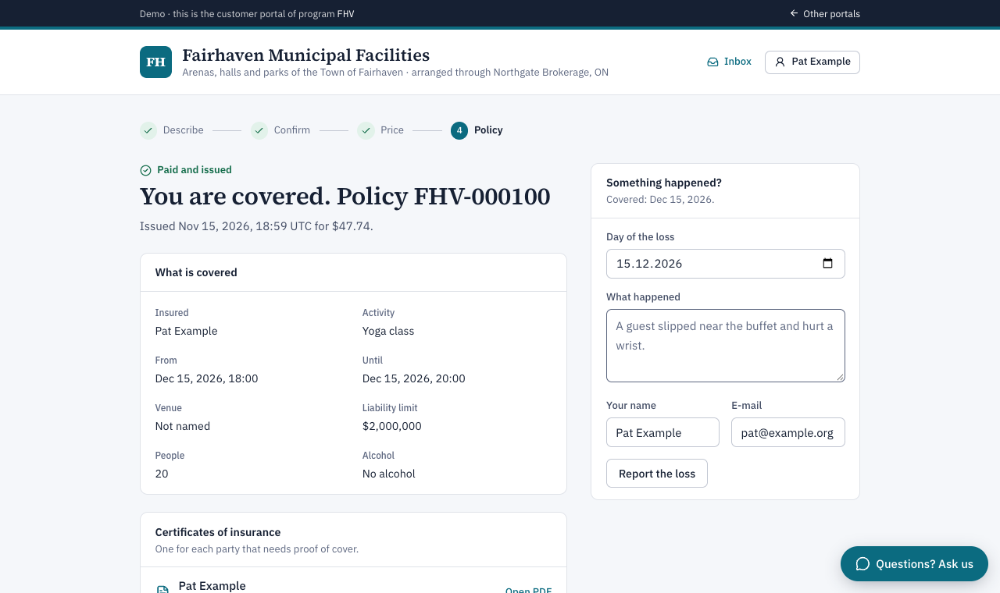
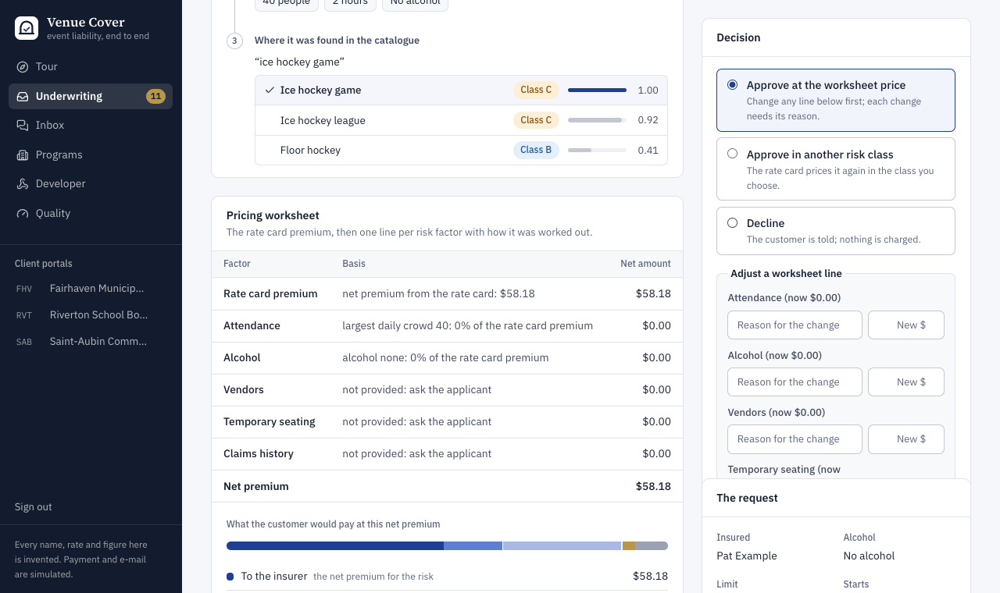
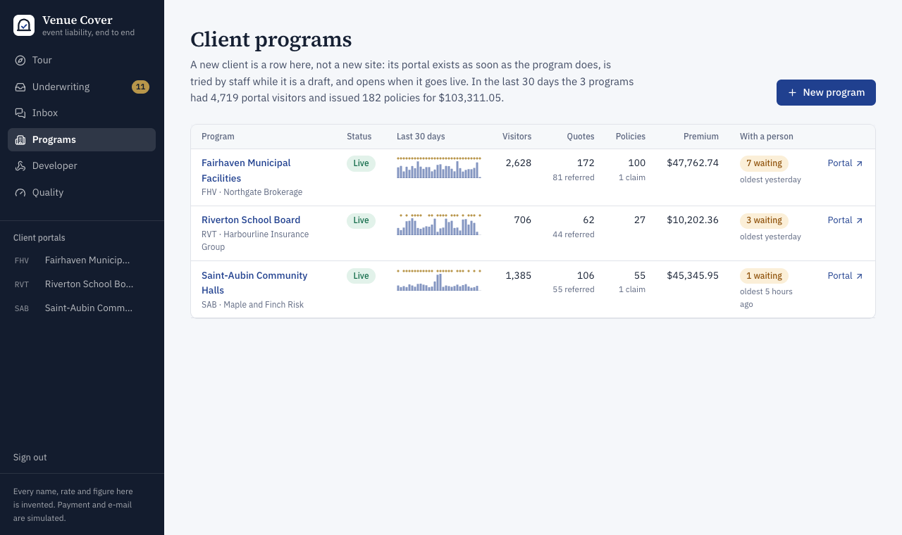
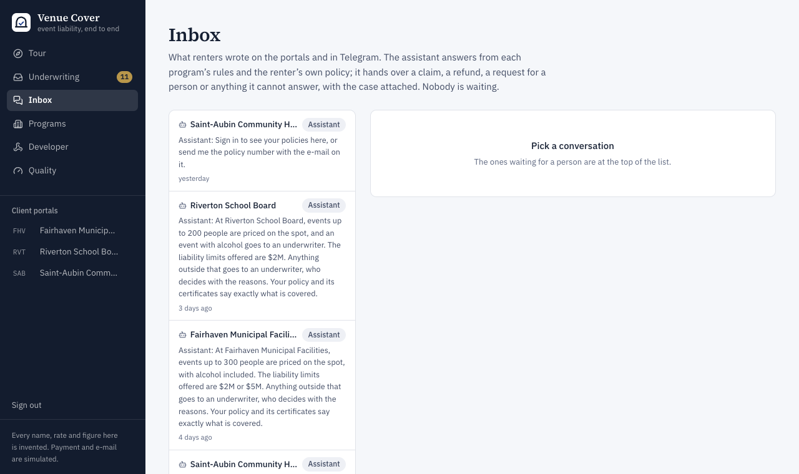
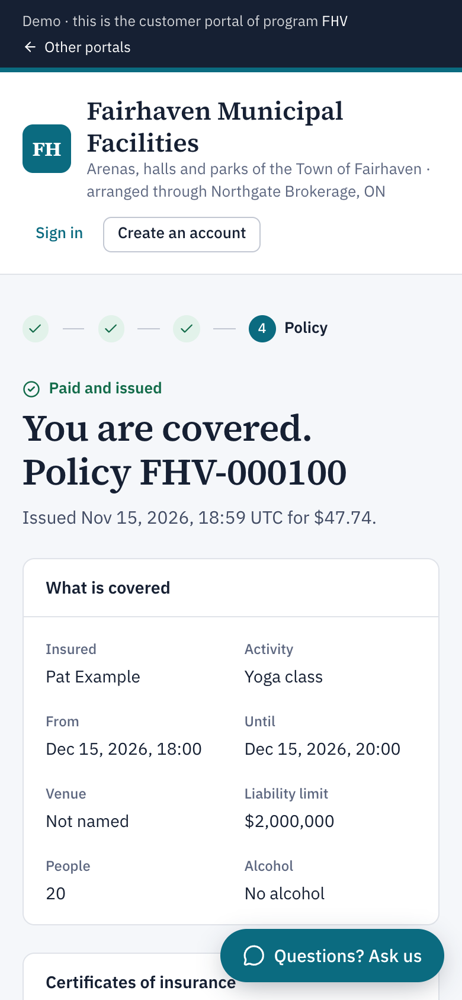
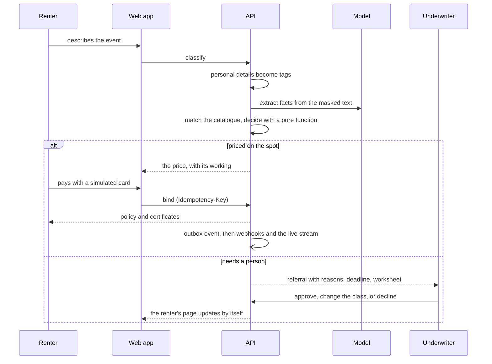
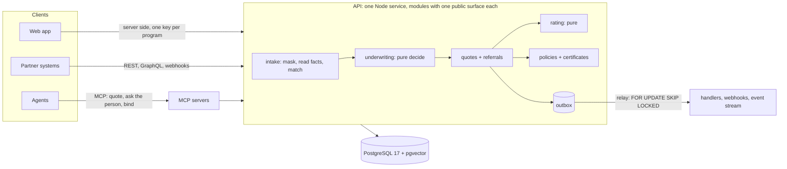

# Venue Cover

**A working platform for event-liability insurance on venue rentals.** A renter describes an event in plain words; the
platform reads it, prices it from the client's own rules, and either issues the policy with a certificate for each party or
hands the case to an underwriter, with the reasons.

[](docs/media/venue-cover-tour.mp4)

https://github.com/user-attachments/assets/50ed347f-503f-4d63-8336-210c544c4906


<p align="center">
  
  
  
  
  
  
</p>

<p align="center">
  <a href="https://venue-cover.bogdangavrilyuk5.workers.dev/p/FHV"><b>Live demo</b></a> ·
  <a href="https://t.me/venue_cover_demo_bot"><b>Telegram bot</b></a> ·
  <a href="docs/media/venue-cover-tour.mp4"><b>Watch the tour</b></a> ·
  <a href="#try-it">Run it</a> ·
  <a href="docs/WHY.md">Why it is built this way</a> ·
  <a href="docs/adr">Decision records</a> ·
  <a href="docs/events.md">Event reference</a>
</p>

> Every name, rate, broker, venue and figure in this repository is invented by [`data/generate.ts`](data/generate.ts). Payment
> and e-mail are simulated behind interfaces with a recording fake. Nothing here comes from a third party's files. The live
> demo and the Telegram bot run from one computer, so they can be offline; the tour shows everything in them.

## What it does

| | | |
|---|---|---|
|  |  |  |
| **A sentence becomes a price.** The renter sees how the text was read: the facts, the catalogue match and its score, and the program's verdict. | **Paid, issued, certified.** A policy and a certificate for each party that needs proof of cover, on any screen. | **A person where it matters.** Referrals arrive with reasons, a deadline and a worksheet that shows the basis of every line. |
|  |  |  |
| **A client is data, not a new site.** Draft, test, live, paused; its own look, contacts and a launch checklist. | **Ask on the portal or in [Telegram](https://t.me/venue_cover_demo_bot).** An assistant answers from the rules, with no number asked for, and hands claims to staff with the policy attached. | **On a phone.** The same portal, laid out for a renter paying from a hall's front desk. |

## What it demonstrates

| Capability | How it shows up | Look at |
|---|---|---|
| **API design** | 68 documented REST operations, with an OpenAPI document generated from the routes and a test that fails when one is undescribed; GraphQL over the same services; a live event stream; stable error codes; `Idempotency-Key` on every write. | [`operations.ts`](apps/api/src/http/operations.ts) · [`schema.graphql`](apps/api/src/graphql/schema.graphql) |
| **Events and integrations** | A transactional outbox, a relay that drains it with `FOR UPDATE SKIP LOCKED`, HMAC-signed webhooks with backoff, replay and a test event. | [`events.md`](docs/events.md) · [`modules/events`](apps/api/src/modules/events) · [`modules/webhooks`](apps/api/src/modules/webhooks) |
| **Data modelling** | Eight SQL migrations; effective-dated rates and versioned program rules; money in integer cents with premiums that always add up; frozen policy snapshots; an audit log. | [`migrations`](apps/api/migrations) · [`modules/rating`](apps/api/src/modules/rating) · [`modules/programs`](apps/api/src/modules/programs) |
| **A multi-tenant platform** | Onboarding a client is a form and a checklist. Appearance is checked for contrast, every change is logged, the client gets a revocable console link and a one-line button for its own website. | [`modules/tenants`](apps/api/src/modules/tenants) · [`modules/setup`](apps/api/src/modules/setup) |
| **Automation with guardrails** | Rules first, the model second; where they disagree, the stricter reading wins. The measure that must stay at zero is an event priced without a person that needed one. | [`modules/intake`](apps/api/src/modules/intake) · [`evals`](evals) |
| **Privacy by construction** | Names, contacts and card numbers become keyed tags before any model reads the text; originals are sealed and shown only to keys allowed to see them. | [`modules/privacy`](apps/api/src/modules/privacy) · [ADR 9](docs/adr/0009-privacy-shield.md) |
| **Agents over MCP** | Two MCP servers on the same API. The person confirms before money moves or a portal opens, and an agent's key reads people only as tags. | [`apps/mcp`](apps/mcp) |
| **A web product** | Next.js with five back-office areas and a renter portal. The browser never holds an API key; a nonce-based CSP, per-visitor rate limits, keyboard access and contrast checks. | [`apps/web`](apps/web) |
| **Architecture ownership** | Service boundaries enforced by a test, contracts written down (OpenAPI, the GraphQL schema, the event reference), data modelling in migrations, and eleven decision records that name what each choice rejected and what it cost. | [`docs/WHY.md`](docs/WHY.md) · [`docs/adr`](docs/adr) |
| **Engineering discipline** | More than 600 tests, 41 of them end to end in a real browser, behind one gate (lint, types, all suites) that the CI workflow runs on every push. Modules can be imported only through their `index.ts`, and a test enforces it. | [`scripts/check`](scripts/check) · [`.github/workflows/ci.yml`](.github/workflows/ci.yml) |

## Try it

You need Node 22.12 or newer (22.11 works with a flag the scripts add) and Docker, for PostgreSQL 17 with pgvector.

```bash
npm install
npm run demo
```

Open <http://localhost:3100>. The database is created fresh on every start and removed on stop. The model is a recording of
a local 14B model for the one-click examples and a plain keyword reader for any other text, so nothing needs a key. Set
`LLM_PROVIDER=ollama` or `anthropic` to use a real one ([`.env.example`](.env.example)).

<details>
<summary><b>Serve it to the internet from one machine</b></summary>

`npm run public` prints two links: the **customer portal**, where anyone can create an account (the confirmation e-mail
appears in a demo inbox on the site), and the **admin console**, which asks for a password made on the first run and kept in
`.env.public`. With no setup it uses a Cloudflare quick tunnel; with a named tunnel's token and a Worker address in
`.env.public` the address never changes ([ADR 10](docs/adr/0010-stable-address.md)). A demo served this way is at
<https://venue-cover.bogdangavrilyuk5.workers.dev/p/FHV>. It runs from one computer, so it can be offline; the tour above
shows everything in it.

The demo's Telegram bot, [@venue_cover_demo_bot](https://t.me/venue_cover_demo_bot), is the same assistant: tap a venue, ask
about cover or prices without any number, or send a policy number with its e-mail to see where a policy stands. A claim goes
to a person with the policy added. Its menu button opens the portals inside Telegram, as a Mini App. `/help` lists what it
does.

The public demo opens on a month of invented business on the three portals (`DEMO_HISTORY_DAYS`, 30 there and 0 for
`npm run demo` and the tests). It is played through the API with the clock set in the past: renters describe events and pay,
underwriters decide referrals, a few report losses, some ask the chat. So the hub, the policy lists and the
inbox agree with each other, as after a real month.

</details>

## How it works





- **Rules first, the model reads.** The model only extracts facts from the text; a pure function decides from the facts, the
  catalogue match and the program's rules. The text is data, never an instruction, and a disagreement between the model and the
  plain rules takes the stricter reading and sends the case to a person ([ADR 4](docs/adr/0004-rules-first-intake.md)).
- **The model never sees personal details.** Names (a local NER model), contacts, addresses, card and SIN numbers become tags
  like `[NAME#7K3Q2A]`, keyed per client program, before any model reads the text; the originals are sealed with the program's
  key and shown only to keys allowed to see them, so the renter and the underwriter read the real text. A guard on the model
  strips anything a call site forgot. Of 1,040 details planted in 400 invented descriptions, 4 reached the model
  ([ADR 9](docs/adr/0009-privacy-shield.md)). An agent gets the same treatment: its key has no `personal:read`, so every person
  in an answer reaches it as tags, from one hook in front of every route; it can hand a tag back to quote for the same person,
  and the person sees the real name only in the confirmation before paying.
- **Money is integer cents** and a premium always splits into net, commission, margin, fee and tax that add up to the total.
- **Every state change writes an event in the same transaction** and a relay delivers it
  ([ADR 3](docs/adr/0003-postgres-as-queue.md), [events](docs/events.md)). Every state-changing POST takes an `Idempotency-Key`.
- **A modular monolith** whose modules can be imported only through their `index.ts`, enforced by a test
  ([ADR 1](docs/adr/0001-modular-monolith.md)). REST, GraphQL and MCP are three views of the same services
  ([ADR 5](docs/adr/0005-rest-graphql-mcp.md)).

The longer reasoning, with what each choice gave up, is in [`docs/WHY.md`](docs/WHY.md).

## How well it works

261 invented descriptions with known answers (typos, French, paraphrase, injection attempts, missing facts, unknown
activities, personal details), judged against one program's rules. Intervals are 95% Wilson.

| Setup | Activity found | Routed right | Priced unseen | Unsafe |
|---|---|---|---|---|
| Plain keyword reader, offline words | 76.7% | 57.1% | 18.4% | 0 |
| Local 14B model, offline words | 83.1% | 72.4% | 33.7% | 0 |
| Local 14B model, multilingual embeddings | 86.3% | 87.7% (83–91) | 49.0% | 0 |

*Unsafe* means an event that needed a person but was priced without one. It is 0 for every setup, and for the last one at
every confidence threshold from 0.4 to 0.9. A shadow replay compares today's model and rules with what people decided.

**Read these as optimistic.** The descriptions and answers were written for this project, and the embedder's scale (three
numbers) was chosen on the same set. The model's answers are recorded in [`evals/recordings`](evals/recordings), so retrieval
and scoring can be tuned and regression-tested in seconds without the model
([ADR 6](docs/adr/0006-recorded-answers-and-scale.md)).

## Work with it

```bash
scripts/check            # lint, types, API tests, MCP, web unit tests, end-to-end tests in Chrome
npm run eval -- --provider replay --embedder transformers   # the evaluation, from recorded answers
npm run eval:privacy     # how many planted personal details reach a model
npm run key -w apps/api -- --name ops --scopes programs:manage,quotes:read   # print an API key once
```

Two MCP servers sit on the same API: one quotes and binds (the person confirms before paying), one sets a client up from its
letter (`draft_client`, `set_appearance`, `preview_client`, `publish_client`; the person confirms before the portal opens).
Locally: `VENUE_MCP=onboarding VENUE_API_KEY=<a key with programs:manage only> npm run start:stdio -w apps/mcp`; over HTTP they
are `/mcp` and `/mcp/onboarding`. Whatever the agent changes is in the audit log under its key's name.

| Path | What is there |
|---|---|
| [`apps/api`](apps/api) | The service: Fastify 5, Kysely, PostgreSQL migrations, twenty modules with one public surface each |
| [`apps/web`](apps/web) | The Next.js app: renter portal, back office, client console, embed button |
| [`apps/mcp`](apps/mcp) | The two MCP servers |
| [`data`](data) | Deterministic generators of the invented catalogue, rates, programs and names |
| [`evals`](evals) | The golden set, metrics, recorded model answers and reports |
| [`docs`](docs) | Decision records, the event reference, research briefs, media |

## What was left out, on purpose

- **Per-person sign-in for the back office.** It has one shared password, which is enough for a demonstration and not for a
  business; the browser never holds an API key ([ADR 7](docs/adr/0007-web-without-sign-in.md)). Renters do have accounts, with a
  confirmed e-mail, hashed passwords and a lockout ([ADR 8](docs/adr/0008-renter-accounts.md)).
- **Real payments and e-mail.** Simulated, with test cards that decline or capture twice.
- **Client-specific rate matrices.** One invented rate card in two versions; real programs have their own.
- **A queue or a broker.** PostgreSQL covers it at this size; the ADR says where that stops being true.
- **A Medusa adapter.** The target stack was never confirmed ([ADR 2](docs/adr/0002-not-medusa.md)).

## Licence

[MIT](LICENSE).
